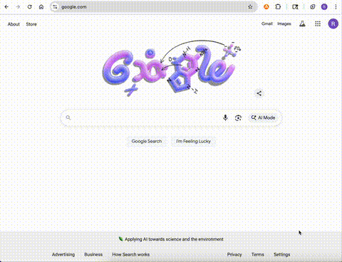

# Spotify Graph

This is a minimal project exploring Spotify graphs with your public playlists. It creates a web interface with the artists added to your public playlists.

## Features

- Visualize your public Spotify playlists as a network graph
- Click on an artist → see their albums
- Click on an album → see its tracks
- Smooth pan/zoom to navigate the graph

#### Features To Add:

- Fix node and text rendering
- Statistics on user's public playlists
- More control over graph display

## Tech Stack

- **Frontend:** React, Vite, D3.js
- **Backend:** Node.js, Express
- **API:** Spotify Web API

## Start Graph

**This app needs your Spotify account**

### 1. Run the backend first

```
cd backend
npm run dev
```

### 2. Run the frontend

While the backend is running, in a new terminal at the root directory, use the following command.

```
npm run dev
```


